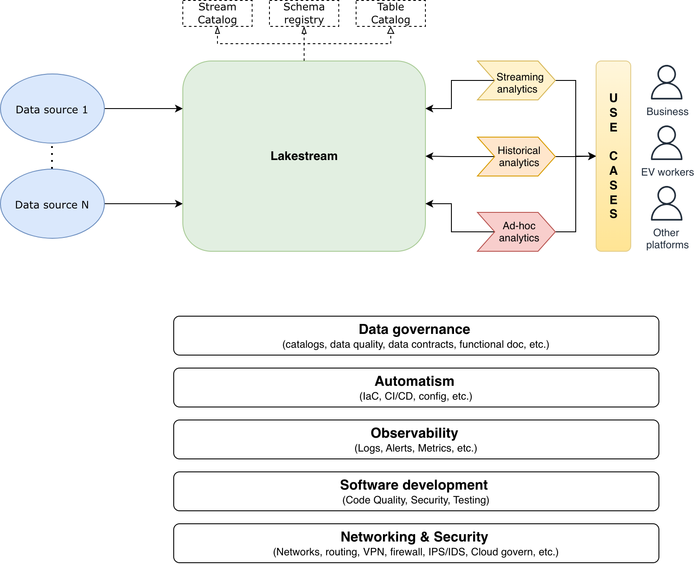
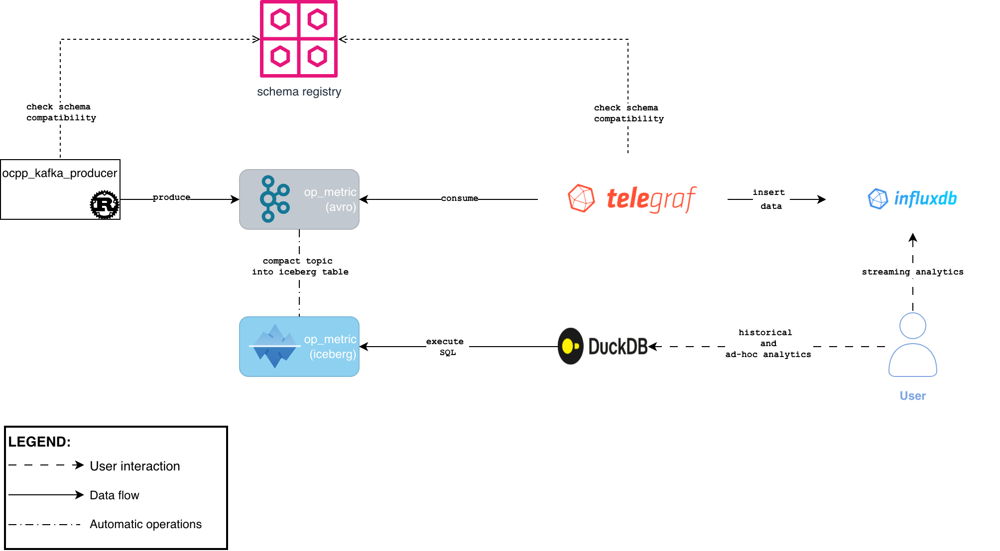
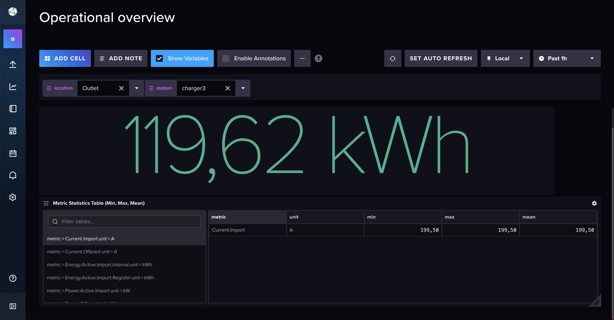
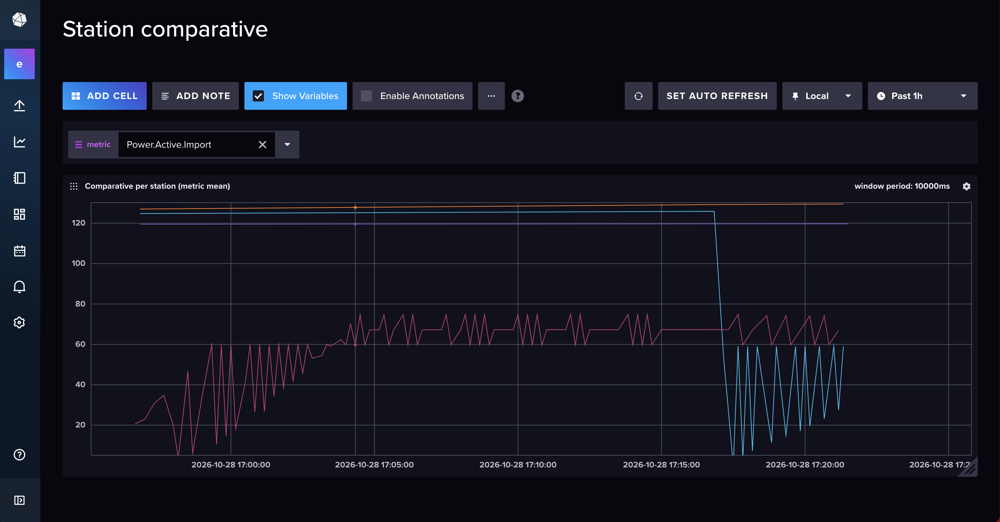
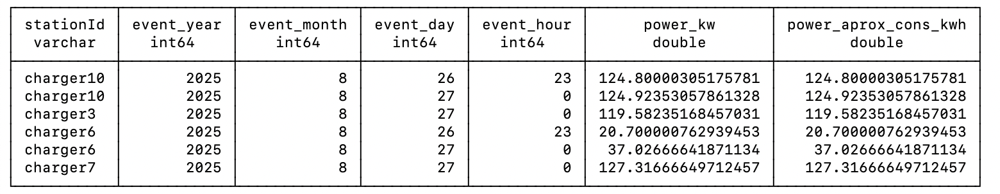
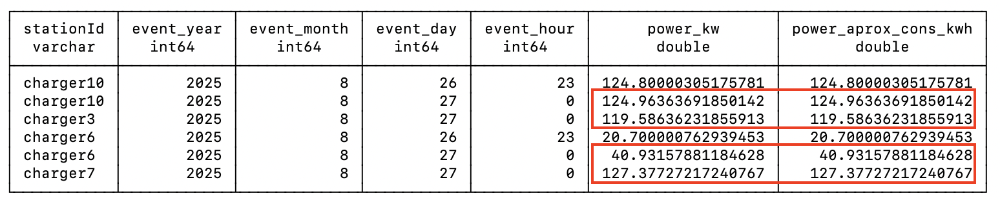

This documentation shows how the challenge is approximated.

# Main goals
Build a data platform which: 
* offers a unique source of truth
* generates business value as soon as data is generated
* facilitates operational status analysis (both streaming and historical)
* improves scalability (capacity of grow)
* and analysis flexibility (ad-hoc analysis)

Taking the main goals in mind I elaborate a table with an eye bird overview and put in place the pieces/abstraction which help us to achieve all goals.

## High level implementation
| Goal                                              | Abstraction                                        | Tools which can be used                                   | Comments                                                                                                                                       |
|---------------------------------------------------|----------------------------------------------------|-----------------------------------------------------------|------------------------------------------------------------------------------------------------------------------------------------------------|
| Unique source of truth (streaming and historical) | Lakestream (~message/events system plus lakehouse) | Open Lakestream, Apache Fluss or Apache Kafka + Lakehouse | Generate the source of truth and also improve the scalability in the future                                                                    |
| Streaming analytics                               | Streaming engine and/or Timeseries database        | Apache Flink and/or Influxdb + grafana                    | Facilitates operational status analysis, getting value as soon as data is generated and further scalability  (both system and new use cases)   |
| Batch analytics                                   | Batch engine                                       | Apache Flink/Apache Spark                                 | Facilitates operational status analysis over historical data for opening new use cases (e.g. predictive maintenance)                           |
| Ad-hoc analysis                                   | SQL query engine                                   | Trino/Athena/DuckDB                                       | Improve the flexibility and offers a system to perform quick analysis                                                                          |

## High level diagram
Putting all together we can find that ideal data platform is as below:



# Prototype
Taking into account the main goals and the high level implementation, we can now put names to the tools for implementing a working propototype. 

## Architecture
### Diagram


#### Diagram elements
* **Producer**: in charge of parse the input data files and publish data to lakestream in AVRO format.
* **Lakestream**: open stream storage system which mixes kafka and iceberg features for offering a unique source of truth.
  * kafka topic for storing  real-time operational metrics events in avro format.
  * schema registry activated to enable data contracts between producers and consumers.
  * iceberg table with the same data schema of kafka topic
* **Telegraf**: read data from kafka topic and publish it to influxdb table.
* **Influxdb**: time-series databases where streaming analytics will be performed.
* **DuckDB**: SQL query engine to perform queries in iceberg tables for ad-hoc analysis.

## Project structure
````
code/
|----ad_hoc_analytics/                # Directory where SQL queries, for duckDB, for ad-hoc analysis are placed
|----ocpp_kafka_producer/             # Directory where all code related to ingestion side is stored
|      |----src/
|      |      |--cli.rs               # Rust code to manage command line interface (mainly parameters)
|      |      |--main.rs              # Rust main code in charge of: parse cli parameters, read input data file, filter metrics events, parse them as avro and send to kafka
|      |      |--models.rs            # Rust structs for managing input file data structures and output data structure
|      |      |--parser.rs            # Rust code for parsing input data file
|      |----Cargo.toml                # Cargo config file for package and dependencies managament
|----streaming_analytics/      # Directory where influx queries for dashboards (variables and cells) are stored
data/                          # Input data files used as source in the ocpp_kafka_producer program
doc/                           # Directory where all docs, guides and diagrams are placed
infra/                         # Directory where services deployment are managed
|----lakehouse/                   # Directory where scripts used in docker-compose.yml are placed (extracted from https://github.com/openlakestream/kafka/tree/4.3-ursa/docker/examples/docker-compose-files/cluster/ursa/lakehouse)
|----time_series_ingest/          # Directory where telegraf config are stored
|----.env                         # Docker enviroment variables used in compose
|----docker-compose.yml           # Docker compose file with all services and config to use
````

## Data Models
### Kafka
#### op_metric
Data model defined is as follows (using kafka nomenclature):
* topic: op_metric
* format: avro
  * schema:
  ```
    {
        "type": "record",
        "name": "OpMetric",
        "namespace": "com.ev.charging",
        "fields": [
          {"name": "event_ts", "type": {"type": "long", "logicalType": "timestamp-millis"}},
          {"name": "stationId", "type": "string"},
          {"name": "location", "type": "string"},
          {"name": "metric", "type": "string"},
          {"name": "value", "type": "float"},
          {"name": "unit", "type": "string"}
       ]
    }
  ```


### Iceberg
* **Database**: lakehouse
* **Schema**: default
* **Table**: op_metric
  * **Schema**:
    * **event_ts**: timestamp
    * **stationId**: varchar
    * **location**: varchar
    * **metric**: varchar
    * **value**: float
    * **unit**: varchar

### Influxdb
#### ocpp_operational_metrics
Data model defined is as follows (using influxdb nomenclature):
* **measurement**: ocpp_operational_metrics
* **tags** (dimensions):
  * stationId
  * location
  * metric
  * unit
* **fields** (metrics):
  * value
* **timestamp**: auto-generated by influxdb to emulate "near-real time data generation"

### What this prototype brings
* A little simple-dashboard with some stats about operational metric in real time.
* A little example about doing ad-hoc analysis using historical data.
* An end-to-end data-platform which offers a proof of concept for growing and scale with small changes.
* A rust kafka-producer trying to do functional programming (I try my best, I promise :D) with some unit tests. 
  * Disclaimer: It's one of my first rust development so don't take it too seriously.
* [How to guide](./how-to.md) to run it locally.
* This small and pretty doc.

### What this propotype DOESN'T bring :(
* Production ready version of services used (kafka, influxdb, object storage, etc.).
* Cross services definition or implementation (data governance, automatism, observability, etc.).
* Historical analytics using batch engine.
* Event time processing because entries in input data files has timestamps from past.
* Only operational metrics are parsed.

## Results
### Streaming analytics
To show value in "real time" we develop two simple dashboards: 
1. First to see an operational overview of metrics stats and dynamic energy consumption aproximation

3. In the second dashboard we can compare metrics (mean) by station



We can see the business value of this type of development, it brings us fresh data when it occurs and opens a lot of opportunities to implement new use cases with real value like: real-time system alerting, forecasting, remote operations control of stations and the infraestructure around it, etc.

### Ad-hoc analytics
Here we show the results of executing sql queries using duckdb over lakehouse table with operational metric data. In the first screenshot we can see the first resultsand then, in the second one, we can see how the columns power_kw and power_aprox_cons_kwh update its value (updates are marked in red on the image).



Batch and ad-hoc analytics add a big value too, due to the possibility of doing ad-hoc analysis with simplicity and extending it to batch jobs, so we can generate data for training machine learning models (e.g: forecasting or predictive maintenance).


# Final considerations
In this section we are going to cover the "things" we must improve to bring this system to production.

## Shortcuts
* Only metric events, from input file, are parsed.
* Security is not implemented: secrets manager for credentials, data encryption, data permissions, granular services permissions, etc.
* Standalone services deployment: all services have been deployed using 1 instance (mainly to a lack of local resources).
* All code related to dashboards is stored as influx code inside this repo instead of having a tool to manage it.

## Technical debt
* Producer: 
  * doesn't implement logging
  * doesn't implement logic for specific errors
  * doesn't use automatism (lint, code analysis, code quality, etc.)

## To be production ready
* Replace standalone deployments with cluster deployments.
* Use an IaC tool for services deployments instead of docker-compose file.
* Use CI/CD tools to ensure good practices in integrations and deployments.
* Enable security by default: central user management, using secure credentials, encrypt data, access control, etc.
* Implement observability (services and process monitoring, metrics, alerts).
* Develop processes for lakehouse maintenance (vacuum, compaction, snapshots) and good practices (partitioning, filtering, etc.)
* Consider move to cloud if in-house team doesn't have capacity for operating the platform. Also, if they want to auto-scale "easily and quickly" on demand.
